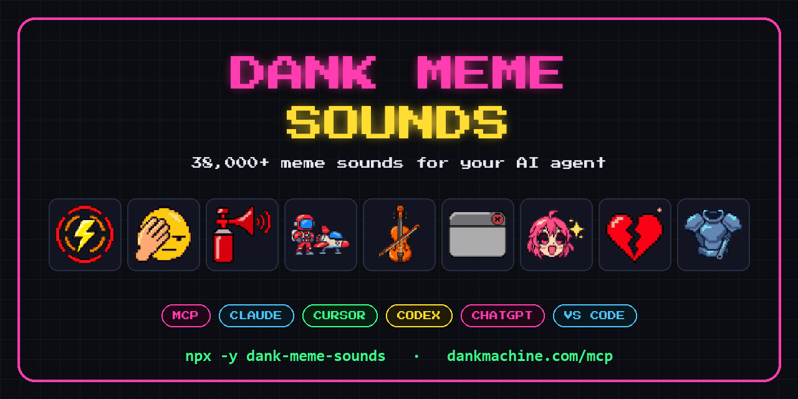
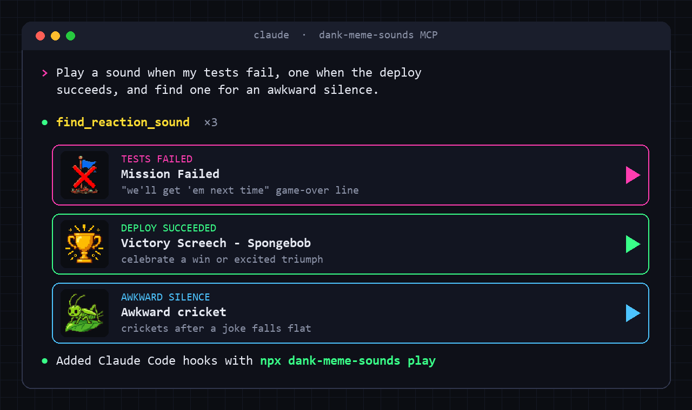

<div align="center">

<a href="https://dankmachine.com/developers/"></a>

### Your AI agent deserves a vine boom.

**38,000+ meme sound effects for Claude, Cursor, Codex, ChatGPT and any MCP client.**<br>
Describe a moment, get the perfect sound. Search, trending, and play it out loud.

[](https://www.npmjs.com/package/dank-meme-sounds)
[](https://www.npmjs.com/package/dank-meme-sounds)
[](https://registry.modelcontextprotocol.io/v0/servers?search=com.dankmachine/dank-meme-sounds)
[](https://github.com/HalberdLLC/dank-meme-sounds/stargazers)
[](LICENSE)

[](https://cursor.com/en/install-mcp?name=dank-meme-sounds&config=eyJ1cmwiOiJodHRwczovL2RhbmttYWNoaW5lLmNvbS9tY3AifQ==)
[](https://insiders.vscode.dev/redirect/mcp/install?name=dank-meme-sounds&config=%7B%22type%22%3A%22http%22%2C%22url%22%3A%22https%3A%2F%2Fdankmachine.com%2Fmcp%22%7D)
[](https://insiders.vscode.dev/redirect/mcp/install?name=dank-meme-sounds&config=%7B%22type%22%3A%22http%22%2C%22url%22%3A%22https%3A%2F%2Fdankmachine.com%2Fmcp%22%7D&quality=insiders)

[**Quick start**](#-quick-start) · [**Tools**](#-tools) · [**Hook recipes**](#-sound-effects-for-your-coding-agent) · [**REST API**](#-rest-api) · [**Browse sounds**](https://dankmachine.com)

</div>

<br>

<div align="center">

</div>

<br>

## 🤔 Why

Coding agents finish tasks in silence. Chatbots can't tell a **vine boom** from a **sad trombone**. Every meme soundboard is built for humans clicking buttons.

`dank-meme-sounds` is the soundboard built for agents:

| | |
| --- | --- |
| 🔊 **38,000+ sounds** | Vine boom, bruh, sad violin, airhorn, Windows XP error, anime wow, metal pipe, emotional damage, and every reaction sound the internet runs on. |
| 🧠 **Agents understand them** | Every sound has AI-written metadata: what it is, **when to use it**, moods, use cases and alternate names. Your agent picks the sound; you don't paste links. |
| 🎯 **Describe a moment** | `find_reaction_sound("my code finally compiled")` returns the sounds that fit, ranked. |
| 📈 **Live trending** | What people actually play on [dankmachine.com](https://dankmachine.com) in the last hour, day or week. |
| ▶️ **Plays out loud** | The local server plays sounds on your speakers (macOS, Windows, Linux). One line turns it into a Claude Code or Codex hook. |
| 🆓 **Zero friction** | Remote server, no install, no API key, no account. Or `npx -y dank-meme-sounds`. MIT. |

## 🚀 Quick start

> **Fastest:** point any MCP client at `https://dankmachine.com/mcp` (Streamable HTTP, no auth).

<details open>
<summary><b>Claude Code</b>: plugin (MCP server + meme-sounds skill)</summary>

```
/plugin marketplace add HalberdLLC/dank-meme-sounds
/plugin install dank-meme-sounds@dankmachine
```

The skill teaches Claude when a sound fits, and keeps `play_sound` for when you ask for it.

Or just the remote server:

```bash
claude mcp add --transport http dank-meme-sounds https://dankmachine.com/mcp
```

Or the local server (adds `play_sound` on your speakers):

```bash
claude mcp add dankmachine -- npx -y dank-meme-sounds
```

</details>

<details>
<summary><b>Claude.ai / Claude Desktop</b></summary>

Settings → Connectors → **Add custom connector** → paste `https://dankmachine.com/mcp`.

Want local playback too? Add to `claude_desktop_config.json`:

```json
{
  "mcpServers": {
    "dankmachine": { "command": "npx", "args": ["-y", "dank-meme-sounds"] }
  }
}
```

</details>

<details>
<summary><b>ChatGPT</b></summary>

Turn on developer mode for connectors, add a custom MCP connector, paste `https://dankmachine.com/mcp`, no authentication.

</details>

<details>
<summary><b>Cursor</b></summary>

Click [**Install in Cursor**](https://cursor.com/en/install-mcp?name=dank-meme-sounds&config=eyJ1cmwiOiJodHRwczovL2RhbmttYWNoaW5lLmNvbS9tY3AifQ==), or add to `~/.cursor/mcp.json`:

```json
{
  "mcpServers": {
    "dank-meme-sounds": { "url": "https://dankmachine.com/mcp" }
  }
}
```

</details>

<details>
<summary><b>VS Code</b></summary>

Click [**Install in VS Code**](https://insiders.vscode.dev/redirect/mcp/install?name=dank-meme-sounds&config=%7B%22type%22%3A%22http%22%2C%22url%22%3A%22https%3A%2F%2Fdankmachine.com%2Fmcp%22%7D), or add to `.vscode/mcp.json`:

```json
{
  "servers": {
    "dank-meme-sounds": { "type": "http", "url": "https://dankmachine.com/mcp" }
  }
}
```

</details>

<details>
<summary><b>OpenAI Codex CLI</b></summary>

`~/.codex/config.toml`:

```toml
[mcp_servers.dankmachine]
command = "npx"
args = ["-y", "dank-meme-sounds"]
```

</details>

<details>
<summary><b>Gemini CLI</b></summary>

```bash
gemini extensions install https://github.com/HalberdLLC/dank-meme-sounds
```

</details>

<details>
<summary><b>Windsurf / Cline / Zed / anything else</b></summary>

Remote:

```json
{ "mcpServers": { "dank-meme-sounds": { "url": "https://dankmachine.com/mcp" } } }
```

Local (stdio, Node.js 20+):

```json
{ "mcpServers": { "dankmachine": { "command": "npx", "args": ["-y", "dank-meme-sounds"] } } }
```

</details>

## 🧰 Tools

| Tool | What it does | Try |
| --- | --- | --- |
| `find_reaction_sound` | Describe a moment, get the best-fitting sounds with what each means and when to use it | *"my build failed again"* |
| `search_sounds` | Search by name, alias, tag, mood or use case | *"vine boom"*, *"minecraft"*, *"anime"* |
| `get_trending_sounds` | What people are playing on DankMachine right now (`1h`, `24h`, `7d`) | *"what's trending today?"* |
| `get_sound` | One sound with its full story: origin, how it's used, variations | `vine-boom-sound-70972` |
| `random_sound` / `get_random_sound` | Random pick, optionally by category or vibe (funny, hype, cursed, wholesome, scary, sad, epic…) | *"random cursed sound"* |
| `list_categories` | Categories with counts: memes, gaming, reactions, anime, brainrot, TikTok… | |
| `browse_sounds`, `list_filters` | **Remote.** Filter the catalog by category, mood, use case, platform | *"short hype sounds for TikTok"* |
| `play_sound` | **Local.** Plays the sound on your speakers | *"play an airhorn when the tests pass"* |

Every result has the title, an `audio` MP3 URL, pixel-art `image` when available, and its `page` on dankmachine.com.

### 💬 Prompts to try

- *"Play vine boom when the tests pass and sad violin when they fail."*
- *"Find 5 short sounds for my pixel game: victory, fail, dramatic reveal, punch, goofy reaction. Download them into ./audio."*
- *"What are the top 5 trending meme sounds today?"*
- *"Give me a sound for the awkward silence at 0:42 in my video."*
- *"Three hype sounds for my stream intro, with links."*

## 🔔 Sound effects for your coding agent

`npx dank-meme-sounds play "<anything>"` finds the best match and plays it. It caches after the first play, and it never fails a hook: no sound, no network, still exit 0.

**One command** adds a Stop hook (vine boom) and a Notification hook (Discord ping) to Claude Code, leaving your other hooks alone (`--project` writes `.claude/settings.json` instead):

```bash
npx -y dank-meme-sounds init
```

**Or by hand** in `~/.claude/settings.json`:

```json
{
  "hooks": {
    "Stop": [{ "hooks": [{ "type": "command", "command": "npx -y dank-meme-sounds play \"vine boom\"" }] }],
    "Notification": [{ "hooks": [{ "type": "command", "command": "npx -y dank-meme-sounds play \"discord notification\"" }] }],
    "SessionStart": [{ "hooks": [{ "type": "command", "command": "npx -y dank-meme-sounds play \"windows xp startup\"" }] }]
  }
}
```

**Codex CLI** (`~/.codex/config.toml`): Codex appends a JSON payload; the CLI ignores it.

```toml
notify = ["npx", "-y", "dank-meme-sounds", "play", "vine boom"]
```

**Your own scripts**

```bash
npm test && npx -y dank-meme-sounds play "victory screech" || npx -y dank-meme-sounds play "mission failed"
```

<details>
<summary>🎛️ Starter pack: sounds that work great as notifications</summary>

| Moment | Try |
| --- | --- |
| Agent finished | `vine boom`, `taco bell bong`, `anime wow` |
| Needs your input | `discord notification`, `among us emergency meeting`, `hello there` |
| Tests passed / deploy done | `victory screech`, `flawless victory`, `roblox win` |
| Something broke | `mission failed`, `windows xp error`, `sad violin`, `bruh` |
| Session start | `windows xp startup`, `nokia ringtone`, `ps1 startup` |

</details>

## 🌐 REST API

The same catalog as a free JSON API. CORS on, no key, cached 60 s.

```
GET https://dankmachine.com/api/v1/search?q=vine%20boom&limit=5
GET https://dankmachine.com/api/v1/reaction?situation=my%20code%20compiled
GET https://dankmachine.com/api/v1/trending?window=24h
GET https://dankmachine.com/api/v1/sounds/<slug>
GET https://dankmachine.com/api/v1/sounds.json        (full catalog)
GET https://dankmachine.com/api/v1/categories.json
```

Docs: **[dankmachine.com/developers](https://dankmachine.com/developers/)**. Please send a descriptive `User-Agent` and link back to sound pages when you show a sound.

## 🧩 Browser extension

[`extensions/chrome`](extensions/chrome): a Chrome/Edge toolbar soundboard: trending, search as you type or describe a moment for a fitting reaction sound, a synced Saved tab, 1-9 hotkeys, Shift+click to copy a link, and right-click → **"Find a meme sound for this text"**. Grab the zip from [Releases](https://github.com/HalberdLLC/dank-meme-sounds/releases) and load it unpacked.

## 🕹️ More from DankMachine

- 🎧 **[dankmachine.com](https://dankmachine.com)**: browse all 38k sounds with pixel art for each
- 💬 **[Live rooms](https://dankmachine.com/rooms/)**: chat where every sound you press plays for everyone
- 📺 **[OBS overlay](https://dankmachine.com/developers/#creators)**: let chat and mods trigger sounds on stream
- ⬆️ **[Upload your own](https://dankmachine.com/upload/)**: get pixel art and tags automatically

## ⚙️ Configuration

| Env var | Default | Purpose |
| --- | --- | --- |
| `DANKMACHINE_API` | `https://dankmachine.com/api/v1` | Point the local server at another catalog |

## ❓ FAQ

<details>
<summary><b>Is it free? Do I need an API key?</b></summary>

Free, no key, no account. The remote server and the REST API are public.
</details>

<details>
<summary><b>Remote or local?</b></summary>

Remote (`https://dankmachine.com/mcp`) needs no install and works in Claude.ai, ChatGPT, Cursor and VS Code. Local (`npx -y dank-meme-sounds`) adds `play_sound` and the `play` CLI for hooks.
</details>

<details>
<summary><b>Can I use the sounds in my commercial game or ad?</b></summary>

Catalog sounds are meme clips from shows, games, songs and creators. Their rights are unverified (`rights_status: "unverified"`), so they are for fun, memes and commentary. Check the source before commercial use. Rights holders can [request removal](https://dankmachine.com/takedown/).
</details>

<details>
<summary><b>A sound is missing!</b></summary>

[Upload it](https://dankmachine.com/upload/) or [open a sound request](https://github.com/HalberdLLC/dank-meme-sounds/issues/new?template=sound-request.yml).
</details>

## 🤝 Contributing

Ideas, bug reports, hook recipes and new client configs are welcome. See [CONTRIBUTING.md](CONTRIBUTING.md).

<div align="center">

### ⭐ If your agent made you laugh, star the repo. It helps other people find it.

<a href="https://star-history.com/#HalberdLLC/dank-meme-sounds&Date">
  <picture>
    <source media="(prefers-color-scheme: dark)" srcset="https://api.star-history.com/svg?repos=HalberdLLC/dank-meme-sounds&type=Date&theme=dark" />
    
  </picture>
</a>

<sub>MIT for the code. Sounds belong to their respective owners. Made by <a href="https://dankmachine.com">DankMachine</a> · Halberd LLC</sub>

</div>
